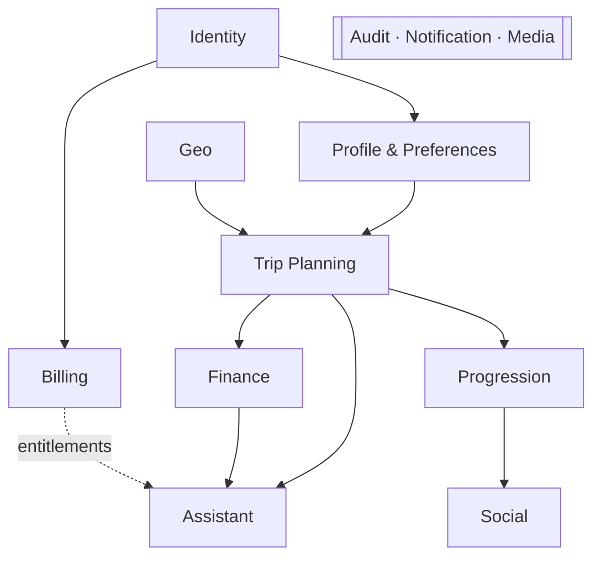
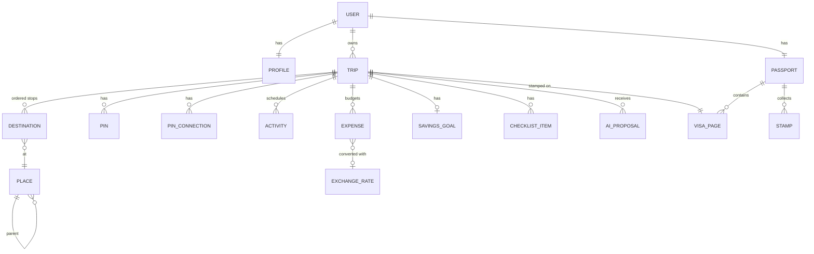

# Domain model

Status: **conceptual, with parts implemented**. The physical schema is in `packages/db` and described in [`data-model.md`](data-model.md#schema-reference). Implemented so far: Identity (user, session, account), Profile and Preferences, the Trip entity with its status, and Audit (events and idempotency keys). Everything else is still to be built in its milestone; the pure rules for stops, days, totals, savings and milestones already exist in `packages/domain`. Rules referenced here are owned by [`../product/business-rules.md`](../product/business-rules.md).

## Bounded contexts

| Context | Entities | Notes |
|---|---|---|
| **Identity** | User, Session, Account (OAuth link), AgentGrant | AgentGrant = scoped, revocable access for external MCP clients |
| **Profile & Preferences** | UserPreference (one row per user; `Profile` later) | `locale`, `currency` (default USD), `homeCountry`, `nationality`, `timeZone`, `units` (#58), `theme` and `motion` (#60). All independent: no field is derived from another. Physical shape: [`data-model.md`](data-model.md#user-preferences) |
| **Geo** | Place, GeocodeCache | `Place` is hierarchical (`country → region → city → district → poi`), with a PostGIS point, ISO codes and localized names |
| **Trip Planning** | Trip, Destination (stop), Pin, PinConnection, ItineraryDay, Activity, Accommodation, Transportation, Checklist, ChecklistItem, Note, Attachment | Described below |
| **Finance** | Budget, Expense, ExchangeRate, SavingsGoal, SavingsEntry | See [`money.md`](money.md) |
| **Assistant** | AIProposal, ProposalChange, AIUsage | A change list with status `proposed / applied / discarded / undone` |
| **Progression** | Passport, VisaPage, Stamp, Milestone, Achievement, XPEvent, Rank | XPEvent is an immutable ledger. Ranks come later |
| **Social** (community, v2) | CommunityProfile (handle), Post (moment, tip, route, visa, goal), Comment, Like, Save, Follow, Mute, Report. Block and Collection later | `canSeePost` decides visibility; shared trips are snapshots ([ADR-0013](adr/0013-community.md)). Physical shape: [`data-model.md`](data-model.md#community) |
| **Media** | MediaAsset | EXIF location stripped by default |
| **Billing** | Customer, Subscription, Entitlement, PlanConfig | Prices live in data, never in code |
| **Notification** | Notification, NotificationPreference | — |
| **Audit** | AuditEvent, IdempotencyKey | Every mutation from AI or MCP is audited |

## Trip Planning details

- **Trip**: `ownerId`, `title`, `startDate` (local date), `currency`, `status` (`active | traveling | completed | archived`), `visibility` (`private` by default). `stage` is **derived**.
- **Destination**: an ordered stop on the route. `placeId`, `position`, `nights`, `state` (`planned | draft`), optional `proposalId`. It is the main pin on the board.
- **Pin**: any other board marker. `kind` (`poi | stay | transport_hub | custom | note`), optional `placeId`, optional `parentDestinationId`, and free coordinates for custom pins.
- **PinConnection**: `fromPinId`, `toPinId`, `kind` (`sequence | alternate | custom`), `label`, optional `transportMode`. Conceptual, not a geographic route.
- **ItineraryDay** is derived from stops and nights. **Activity** links a Place or Pin to a day (or leaves it unscheduled) and carries `done`.
- **Accommodation / Transportation**: structured details (dates, provider, confirmation reference, links). Their costs are Expenses linked by id.

## Relationships (simplified)

## Application layer conventions

- Every operation is a **command** (mutation) or a **query**, with a Zod input/output schema. These schemas later become API contracts and MCP tool contracts.
- Commands take an `actor` (user, Pip on behalf of a user, or an MCP grant) and authorize against it.
- Mutations accept an **idempotency key**. AI- and MCP-originated mutations are always audited.
- Sensitive commands (publishing content, large financial changes, deletes) can require **explicit confirmation**, represented as a pending AIProposal.
