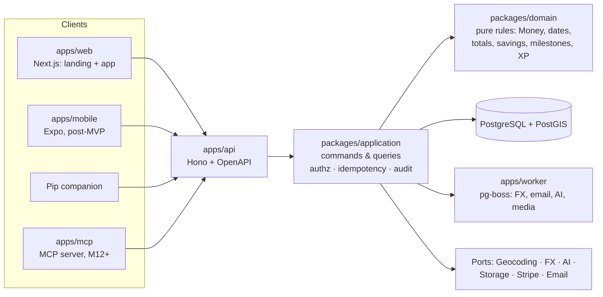

# Architecture overview

Status: **approved direction, partly built**. Decisions are recorded in [`adr/`](adr/). The monorepo exists (M2). "What exists today" below says which boxes of the diagram are real.

## Shape



**The core rule:** web, mobile, Pip, the MCP server, background jobs and admin tools all call the **same** application commands and queries. UI components hold no business rules.

## What exists today

| Piece | State |
|---|---|
| `apps/web` | Built: account screens, settings, a placeholder `/app`, the proxy to the API. No board, itinerary, budget or landing yet |
| `apps/api` | Built: Hono + OpenAPI, Better Auth, `/v1` for `me`, `me/preferences`, `trips`, `auth/providers` |
| `apps/worker` | Placeholder (starts and stops; no jobs). pg-boss comes with the first job |
| `apps/mobile`, `apps/mcp` | Not started (post-MVP) |
| `packages/domain` | Built: money, dates, trip derivations, countries, time zones, ids |
| `packages/application` | Built: the operation convention, ports, trips, preferences, email templates |
| `packages/db` | Built: Drizzle schema (auth, trips, idempotency, audit, preferences), migrations, repositories |
| `packages/api-client`, `tokens`, `ui`, `i18n`, `config` | Built (the UI library keeps growing with #6) |
| Chosen in the ADRs but **not installed yet** | TanStack Query, Zustand, `motion`, Rive, Lucide, MapLibre and Protomaps, `pg-boss`, the Vercel AI SDK, Sentry or GlitchTip, d3 (for static mini-maps). Each arrives with the first feature that needs it; add it with the justification the dependency rules ask for ([`coding-standards.md`](../engineering/coding-standards.md#dependencies-and-comments)) |
| Ports with an adapter | Storage of users, trips, preferences, audit, idempotency (PostgreSQL); email (SMTP). Not yet: geocoding, FX rates, AI, object storage, Stripe |
| Local services | PostgreSQL + PostGIS, S3-compatible storage, Mailpit (`compose.yaml`) |
| Deployment | None. Dockerfiles exist for web, api and worker (M11 deploys) |

## Monorepo (pnpm + Turborepo)

The layout below is the target; the table above says what is there. The folder-by-folder guide is in [`../engineering/project-structure.md`](../engineering/project-structure.md).

```
apps/
  web/        Next.js App Router: marketing (SSG/SSR) + app under /app
  api/        Hono + @hono/zod-openapi (REST, OpenAPI contract)
  worker/     pg-boss consumers
  mobile/     Expo (post-MVP)
  mcp/        Remote MCP server (M12+)
packages/
  domain/       Pure TypeScript domain: entities, value objects (Money), rules. No I/O
  application/  Use cases (commands/queries), Zod schemas, authorization, ports
  db/           Drizzle schema + migrations (PostgreSQL + PostGIS)
  api-client/   Typed client generated from OpenAPI
  tokens/       Design tokens (DTCG JSON → CSS vars / TS)
  ui/           Web component library (React Aria + Tailwind) + Storybook
  i18n/         ICU message catalogs + formatting helpers
  config/       Shared tsconfig, eslint, prettier
```

## Stack summary

| Concern | Choice | ADR |
|---|---|---|
| Language | TypeScript everywhere | 0002 |
| Web | Next.js (App Router), TanStack Query, Zustand | 0002 |
| API | Hono + Zod/OpenAPI (REST); mutations are one transaction with audit and idempotency | 0006, 0011 |
| DB | PostgreSQL 17 + PostGIS, Drizzle ORM | 0002 |
| Jobs | pg-boss (Postgres-backed queue, no Redis in the MVP) | 0002 |
| Auth | Better Auth (email/password, Google, sessions; OAuth 2.1 provider later for MCP). The web app proxies the API so the cookie is first-party | 0005, 0010 |
| Map | MapLibre GL JS + Protomaps PMTiles (OSM), GeoNames places in PostGIS, managed geocoder behind a port | 0003 |
| Money | Integer minor units + ISO 4217, FX rate records | 0004 |
| i18n | ICU messages, `next-intl` (web), `use-intl` (RN) | 0008 |
| UI | React Aria Components + Tailwind v4 + tokens, Storybook | — ([design-system](../design/design-system.md)) |
| Motion | motion/react, CSS, Rive (Pip) | — |
| AI | Vercel AI SDK (provider-agnostic), structured output via Zod | 0007 |
| Media | S3-compatible (Hetzner Object Storage; MinIO locally) | — |
| Email | An `EmailPort` with an SMTP adapter (Mailpit locally). The production provider (Resend or Postmark) is still to be chosen; it is a settings change | 0012 |
| Errors | Sentry-compatible (Sentry or self-hosted GlitchTip) | — |
| Tests | Vitest, fast-check, Playwright, axe-core | — ([testing-strategy](../engineering/testing-strategy.md)) |

## Deployment shape (executed in M11)

Containers `web`, `api` and `worker` run on Hetzner via Coolify, alongside PostgreSQL + PostGIS on a persistent volume. PMTiles and media live in object storage behind a CDN. All configuration comes from environment variables, and secrets live in Coolify. Scheduled `pg_dump` backups go to off-server storage, with a tested restore. Dockerfiles exist from M2, so local and production stay close.
