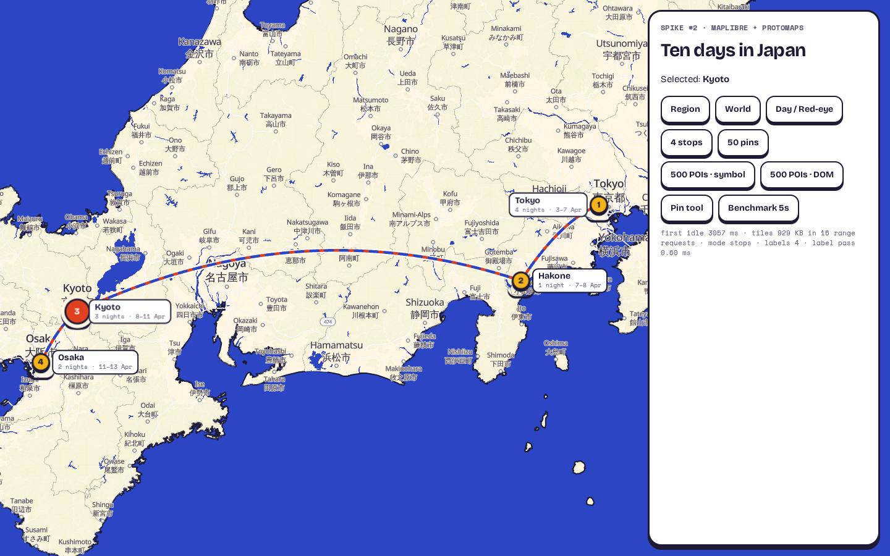
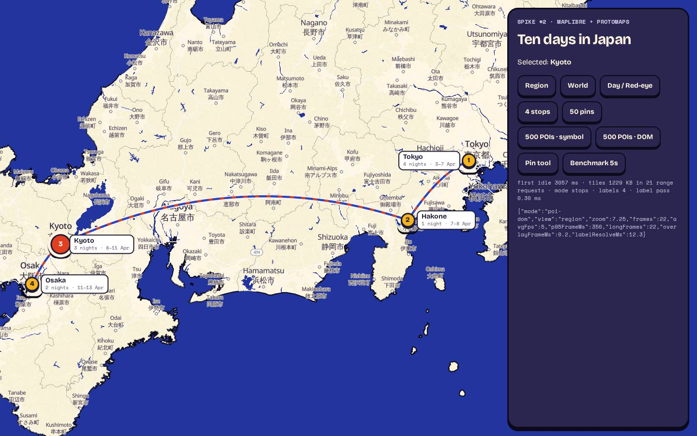
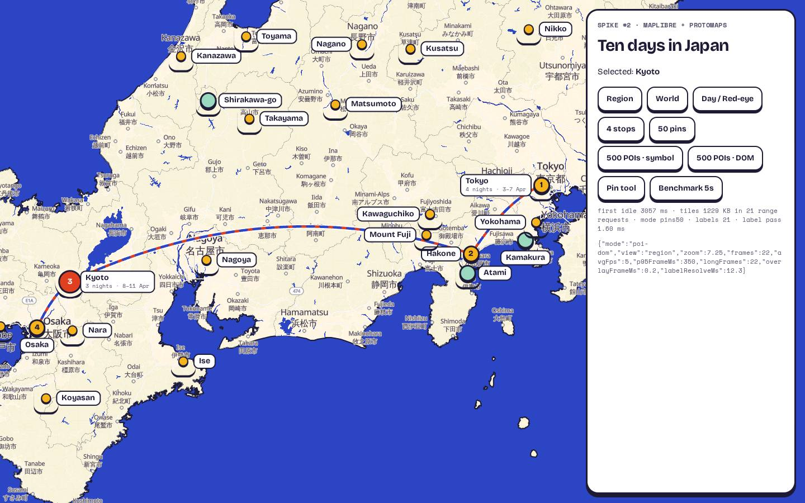
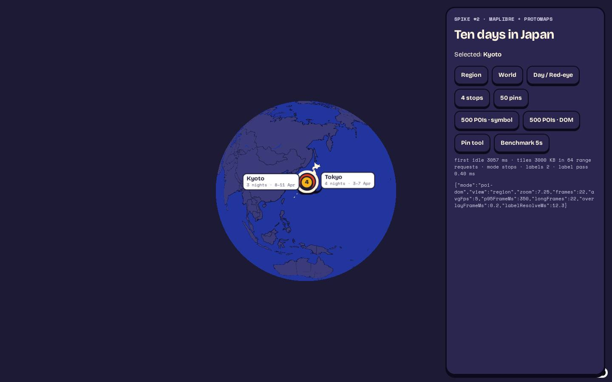
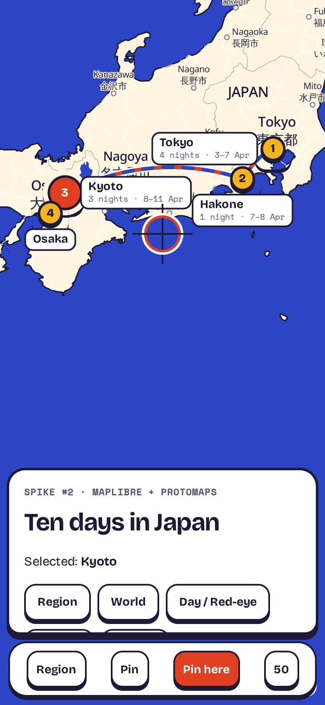
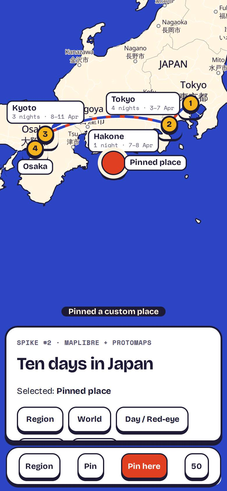

# Spike #2: MapLibre + Protomaps poster map

- **Question:** can MapLibre GL JS plus an OpenStreetMap basemap from Protomaps (PMTiles) reproduce the Globetrot poster look, with crisp, accessible pins and good touch interaction? ([ADR-0003](../adr/0003-map-stack.md))
- **Date:** 2026-11-07
- **Code:** branch `spike/issue-2-maplibre-poster-style` (commit `5191b82`), folder `spikes/maplibre/`. Throwaway; not merged.
- **Verdict: Go, with conditions.**
  - The visual identity, overlay architecture, world ⇄ region transition and mobile crosshair all work.
  - Two criteria are **not met yet**: 60 fps on a real phone GPU (not measurable in this environment) and first render under 2.5 s on 4G (3.4 s measured). Both have concrete fixes, listed below.

## What was built

| Piece | Implementation |
|---|---|
| Basemap | Protomaps daily planet build `20261107`, extracted with `go-pmtiles` into `world-z5.pmtiles` (15 MB) and `japan-z10.pmtiles` (57 MB). Served as static files and read via the `pmtiles` protocol (HTTP range requests) |
| Style | `@protomaps/basemaps` layers with a custom **flavor** built from our tokens: sea `#2B45C4`, land `#C9D3F4`, trip land `#FFF5E1`. Added a land shadow (offset `fill-translate`, `#1E3196`) and a 2px ink coastline. POIs, buildings and landcover are removed for the poster look. Day and Red-eye themes |
| World view | `projection: globe` at zoom ≈ 1.4. MapLibre morphs globe → mercator as you zoom |
| Overlay | Trip pins are `<button>`s with a 44×50 hit area, positioned with `map.project()` and `translate3d` on every `move`. Airmail routes are 3 stacked SVG paths on a lifted quadratic arc with marching dashes (static under reduced motion) |
| Labels | Greedy placement (right → left → below → left-below → above → left-above, then drop the sub-line, else hide). The placement is pure arithmetic over pre-measured sizes, running on `moveend` |
| Transition | `fitBounds`/`flyTo` with 900 ms and the handoff easing. `jumpTo` when reduced motion is on |
| Mobile | A fixed crosshair at the centre of the *visible* map (above the bottom sheet) and "Pin here". It snaps to a known place within 46px, otherwise creates a custom pin |
| Dense layer | 500 POIs as a clustered GeoJSON **symbol/circle layer**, against 500 DOM buttons |

## Results

| Criterion | Target | Result | Status |
|---|---|---|---|
| Poster style matches the design, both themes | Side-by-side | Very close to the prototype (screenshots below) | ✅ |
| Trip pins are buttons, ≥ 44px, labelled | Yes | 44px minimum hit area, `aria-label="Kyoto, stop 3"`, keyboard focusable | ✅ |
| World ⇄ region transition | 900 ms, reduced-motion cut | Works (globe → mercator) | ✅ |
| Mobile crosshair + "Pin here" | Pin lands under the crosshair | Lands at the crosshair centre (Δ 0 px); snapping works | ✅ |
| Overlay JS cost per frame | Fits the frame budget | **0.1–5.6 ms**, even at a 4× CPU slowdown (50 pins) | ✅ |
| Label pass | Off the hot path | 0.3–3.9 ms (50 pins, 4× CPU), on `moveend` only | ✅ |
| 50 pins + routes at ≥ 55–60 fps on a mid-range Android | Real device | **Not measured.** Headless Chromium uses software WebGL (SwiftShader), so frame rates there reflect CPU rasterization, not the app (7 fps desktop / 23 fps phone viewport even with 4 pins) | ⏳ needs a device run |
| First render < 2.5 s on 4G | < 2.5 s | **3.4 s** to first idle (4.5 s to all tiles) with a 4× CPU slowdown and 4G (150 ms RTT, 9 Mbps). 1.29 MB transferred | ❌ fixable |
| DOM vs symbol layer for 500 points | Pick one | Symbol layer: 18.6 fps against 12.4 fps for DOM (phone profile), with no per-frame JS. The DOM version also blocks the main thread | ✅ symbol layer for dense data |

Raw numbers: [`maplibre/bench-results.json`](maplibre/bench-results.json). Method: `spikes/maplibre/scripts/bench.mjs` (Playwright 1.64, Chromium headless, `vite build` + `vite preview`, cache disabled).

## Screenshots

| Day: region | Red-eye: region |
|---|---|
|  |  |

| 50 pins (labels only for stops below z5.2) | World view (globe, Red-eye) |
|---|---|
|  |  |

| Phone: crosshair | Phone: after "Pin here" |
|---|---|
|  |  |

## Findings and decisions for production

1. **Keep the hybrid overlay** (ADR-0003). DOM/SVG for trip pins and routes (up to about 100), MapLibre layers for anything dense. The overlay costs at most a few ms per frame, even on a slow CPU.
2. **Serve tiles from a z/x/y endpoint, not client-side PMTiles range reads.** The client-side protocol needs extra round trips (header, then directories, then tiles) before the first tile, which hurts on 4G (150 ms RTT). Run `pmtiles serve` (or Martin) as a Coolify service behind the CDN: one request per tile, cacheable. The single planet PMTiles file still lives in object storage. *This is the main fix for the 2.5 s target.*
3. **Slim the map bundle.** The spike bundle is 1.9 MB (552 KB gzip), plus a 519 KB worker. Most of the excess is the embedded Natural Earth 50m JSON (used only for the low-zoom highlight) and the map not being code-split. In the app: lazy-load the board route, never bundle geodata, and preconnect and preload the style.
4. **Trip-country highlight needs a country layer.** Protomaps' `earth` layer has no country attribute. The spike's NE-50m polygon only works at low zoom, and in the region view all land is cream (Korea included). Options: a small country-polygon tileset (Natural Earth 10m, or OSM admin level 2) in our tile service, or `within`-filtered fills. *Decide in M4.*
5. **Calm the basemap labels.** Protomaps labels are bilingual (en plus local script) and dense at z7+. For the poster look, keep only country and major-city labels until z8 and localize them through the `lang` option with our UI locale. Our own labels (Bricolage) stay in the overlay. Serving Bricolage as map glyphs would need generated PBF fontstacks; not needed now.
6. **Theme-aware map labels.** In Red-eye, dark labels on non-trip land (`#3B3A7A`) lack contrast. Label colours must depend on land type and theme. Add a contrast check to the style tests.
7. **World view needs a single trip pin.** At world zoom the four stops stack on top of each other. Show one "trip" pin there (as in the prototype) and expand it into stops in the region view.
8. **Crosshair in label collision.** Labels can sit under the crosshair. Add the crosshair box to the collision set while the pin tool is active.
9. **Vite + maplibre-gl v6 setup** (needed for production builds): import the worker with `maplibre-gl/dist/maplibre-gl-worker.mjs?worker&url`, set it with `setWorkerUrl()`, and use `worker.format: 'es'`. Otherwise the worker isn't emitted and the map never loads.
10. **Self-host glyphs and sprites.** The spike loads Protomaps' public assets. Production serves them from our CDN.
11. **Native later.** `maplibre-react-native` v11 is the candidate for Expo (post-MVP). The same style JSON can be reused, and the overlay would be reimplemented with native views.

## Still open (follow-ups)

- **Real-device frame rate.** Run the spike on a mid-range Android (e.g. a Galaxy A-series) and an iPhone. Build it with `cd spikes/maplibre && pnpm install --ignore-workspace && scripts/fetch-tiles.sh && pnpm build && pnpm preview --host`, then open it from the phone on the same network. Record the result from **Benchmark 5s** for each mode. This can also run on the preview environment once it exists (M4).
- Re-measure first render after fixes 2 and 3.
- Pick the managed geocoder (#4) and finish the places dataset (#3).

## Licences and attribution

Map data © OpenStreetMap contributors (ODbL), built by Protomaps. The UI must show the attribution, and the spike uses MapLibre's compact attribution control. Natural Earth is public domain.
